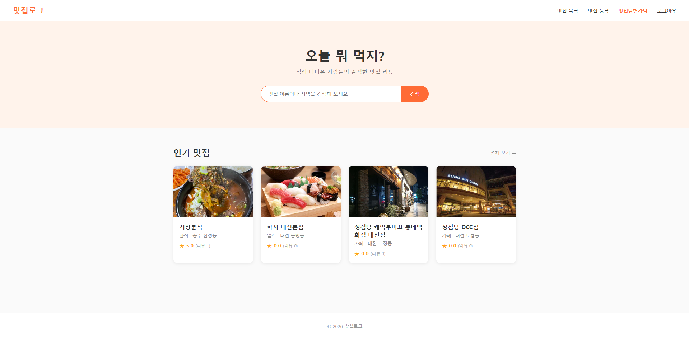
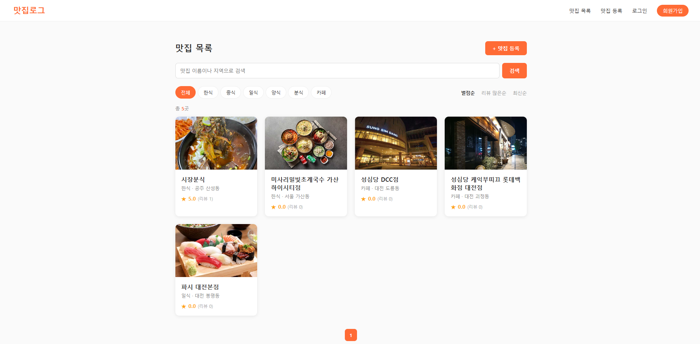
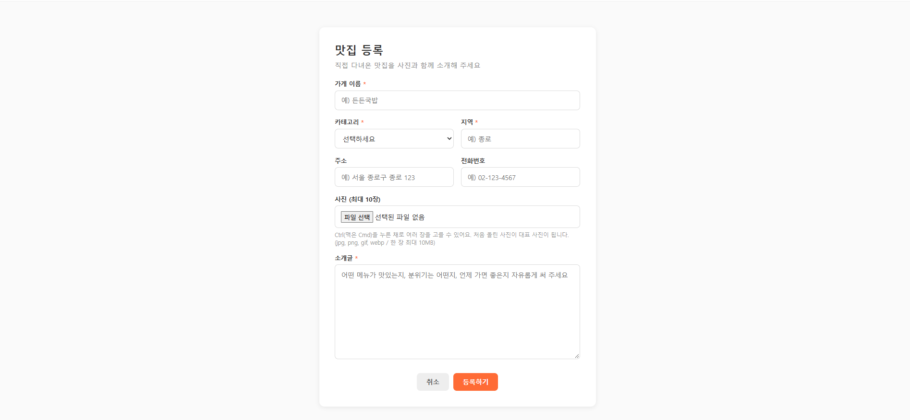
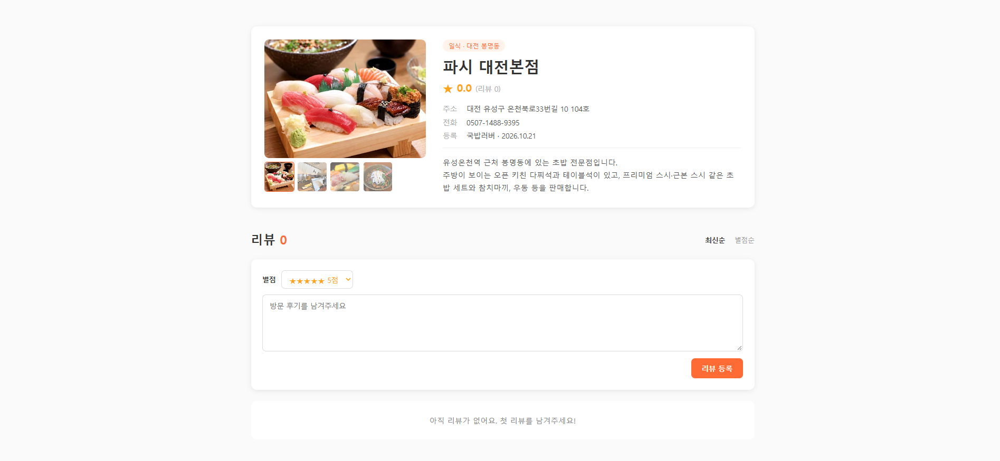
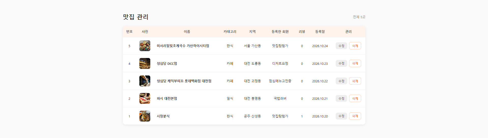
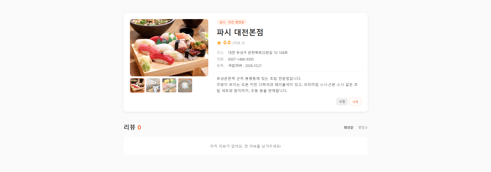

<h1>개요</h1>

DB 구축으로 유저와 전반적인 게시물과 댓글 처리와 저장, 기본적인 로그인과 회원가입 그리고 관리자용 페이지와 관리까지 해서 기본적인 기능 자체는 구현되었습니다
앞으로 여기서 추가 기능이 필요하다면 큰 틀에서 벗어나지 않고 덧붙이는 식으로 구현합니다 
또한 이클립스 프로젝트에 import시 이용가능한 파일은 [릴리즈](https://github.com/edwordTerrif/favhome/releases/tag/1.1.0)를 참조하시길 바랍니다

 

<h1>공통 페이지</h1>

<h3>메인 페이지</h3>

<h3>목록 페이지</h3>

<h3>등록 페이지</h3>

<h3>게시글과 댓글 페이지</h3>

<h3>로그인 페이지</h3>

<h3>회원가입 페이지</h3>

 

<h1>관리자 페이지</h1>

<h3>관리자 목록 페이지</h3>

<h3>전역 삭제와 수정 가능 페이지</h3>

